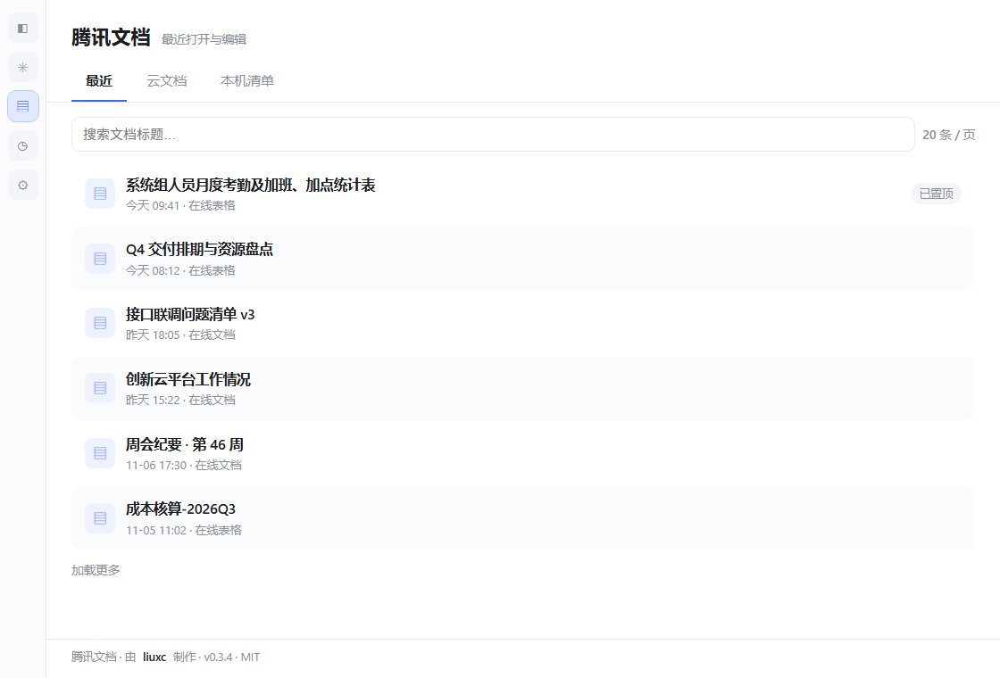
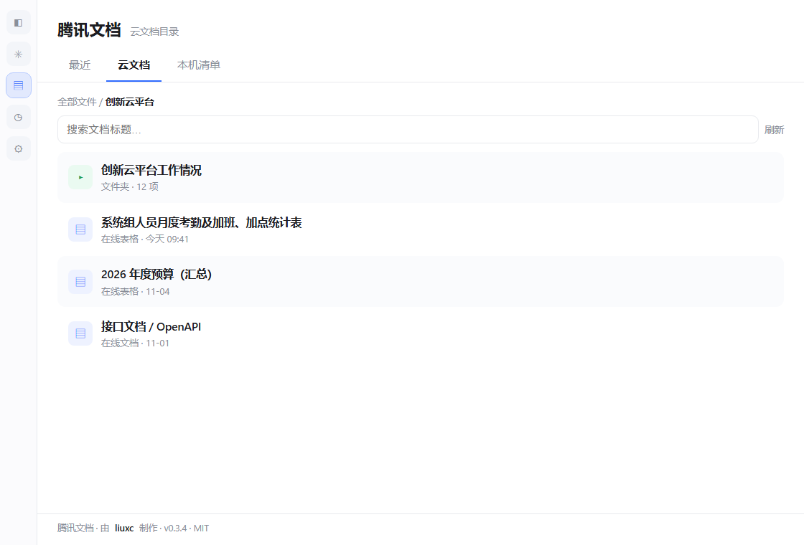
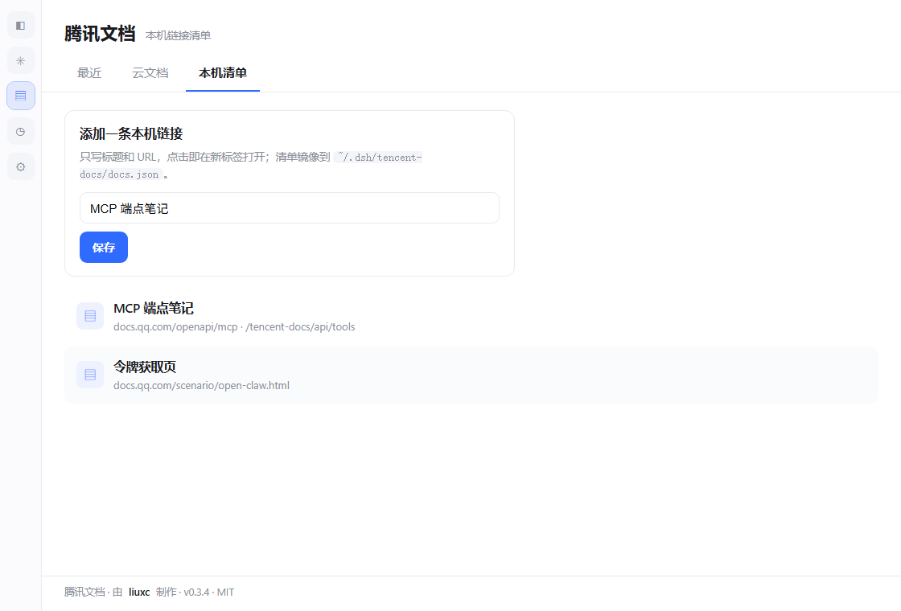

# dsh-tencent-docs

**腾讯文档 in the DSH left sidebar.** Click the icon, get your real recent files, folder tree and title search — read live from Tencent Docs' official MCP endpoint with a token you paste once.

> 由 **liuxc** 制作 · MIT · v0.3.4



## 它长什么样

| 最近 | 云文档 | 本机清单 |
|---|---|---|
|  |  |  |

<sub>以上为面板截图（示意数据，真实条目来自你自己的腾讯文档账号）。</sub>

## 三个标签

- **最近** — `manage.recent_online_file`，每页 20 条，翻页加载；默认首页。
- **云文档** — `manage.folder_list` 逐层下钻真实目录，面包屑导航，`manage.search_file` 按标题搜索，文件点开即在新标签打开。
- **本机清单** — 自己维护的链接清单，镜像到 `~/.dsh/tencent-docs/docs.json`，换浏览器不丢。

## 安装

```sh
dsh plugin --profile desktop add dsh-tencent-docs
```

本地目录 / tarball：

```sh
dsh plugin --profile desktop add "C:\path\to\dsh-tencent-docs"
dsh plugin --profile desktop add "C:\path\to\dsh-tencent-docs-0.3.4.tgz"
```

装完刷新 Web GUI，左侧栏出现文档图标（排在 dsh-context 与 dsh-purge 之间）。

## 授权

1. 点图标，面板会要令牌。
2. 打开 <https://docs.qq.com/scenario/open-claw.html>，QQ/微信登录后复制访问令牌。
3. 粘贴、保存。令牌只由 **Host 半**写入 `%USERPROFILE%\.dsh\tencent-docs\auth.json`（`0600`），浏览器脚本拿不到；「断开」即清除。

## 权限与数据

| 能力 | 用途 | 边界 |
|---|---|---|
| 网络 | 访问 `https://docs.qq.com/openapi/mcp` | 只此一个域名，无遥测、无作者服务器 |
| 读写文件 | `~/.dsh/tencent-docs/` 下 `auth.json`、`docs.json` | 不碰其他路径 |
| 凭证 | 你粘贴的访问令牌 | 只落本机、只发给腾讯文档；接口只回 `len32:…` 摘要 |

沙箱静态扫描会看到 `fs-read` / `fs-write` / `network`；没有 `shell`、没有 `env`、没有 `credentials` 读取。

## HTTP 路由（Host 半，同源）

| 路由 | 方法 | 用途 |
|---|---|---|
| `/tencent-docs/api/recent?page=&count=` | GET | 最近文件（`count` 上限 20） |
| `/tencent-docs/api/tree?folder=&start=` | GET | 目录列举 / 下钻 |
| `/tencent-docs/api/search?q=` | GET | 标题搜索 |
| `/tencent-docs/api/auth` | GET/POST | 令牌状态 / 保存 |
| `/tencent-docs/api/auth/clear` | POST | 清除令牌 |
| `/tencent-docs/api/tools` | GET | MCP 工具清单（缓存 60s） |
| `/tencent-docs/api/load` · `/save` | GET/POST | 本机清单读写 |

错误统一 `{ ok: false, error, authRequired }`；缺令牌 → `401`。

## 已知限制

- 腾讯文档禁止第三方 iframe 嵌入（`frame-ancestors`），所以文件一律新标签打开，面板内不做预览。
- 工具名在运行时按正则解析（端点约 227 个工具，改过名），不硬编码。
- `manage.recent_online_file` 的 `count` 上限 20，传更大值会被拒；Host 侧已截断。
- 免费账号 2000 次 MCP 调用/天。

## Author

**liuxc** — host bridge, client panel, packaging. Fork 或再分发时保留 `package.json` 的 `author` 与面板页脚的「由 liuxc 制作」（MIT 本来就要求保留版权声明）。

## License

MIT © 2026 liuxc
